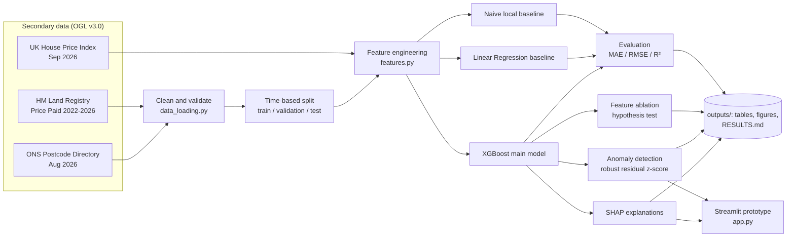

# Design notes

This file explains how the code is built, why some choices were made, which code covers each objective, and how it was tested.

## 1. Requirements

| ID | Requirement | Source |
|---|---|---|
| R1 | Build a cleaned, reusable transaction dataset for selected years and regions | Objective 1 |
| R2 | Create spatial and temporal features (postcode area, type, sale month/year, local price patterns) | Objective 2 |
| R3 | Compare XGBoost with a Linear Regression baseline using MAE, RMSE and R² | Objective 3 |
| R4 | Score each sale for how unusual its price is, compared with the predicted price | Objective 4 |
| R5 | Explain predictions with SHAP | Objective 5 |
| R6 | Use a time-based split, not a random one | Research design (time horizon) |
| R7 | Never show addresses; call anomalies "unusual", never fraud | Ethics form, Risk R5 |
| R8 | Run on a laptop in reasonable time (data is large) | Risk R1 |
| R9 | Provide a usable prototype for professional feedback | Deliverable, evaluation |

## 2. High-level architecture

## 3. Low-level design (modules in `src/propval/`)

| Module | Responsibility | Key functions / classes |
|---|---|---|
| `config.py` | Every setting in one dataclass: paths, years, split dates, thresholds, model parameters, feature groups | `Config`, `ABLATION_SETS`, `FEATURE_GROUPS` |
| `data_loading.py` | Read the three datasets, apply the cleaning rules and log each one, join sales to geography, cache as Parquet | `read_price_paid_files`, `clean_price_paid`, `load_postcode_lookup`, `load_hpi`, `attach_geography`, `load_base_dataset` |
| `features.py` | Fit on training data only, then transform any period or a single property | `FeatureBuilder.fit_transform` (out-of-fold), `.transform` |
| `models.py` | Chronological split; Linear Regression pipeline; XGBoost training, early stopping and random-search tuning | `time_split`, `fit_linear`, `fit_xgb`, `tune_xgb` |
| `evaluation.py` | MAE, RMSE, R², R² (log), MAPE, MdAPE, % within 10% / 20%, per-group metrics | `regression_metrics`, `metrics_by_group` |
| `anomaly.py` | Robust z-score of the log prediction error, calibrated per property type on the validation period | `ResidualAnomalyDetector` |
| `explain.py` | Exact TreeSHAP from XGBoost, global and per-group importance, per-sale explanation in % | `shap_values`, `global_importance`, `explain_row` |
| `plots.py` | All report figures | `fig01` … `fig13` |
| `pipeline.py` | Runs the stages in order and writes the evidence and `RESULTS.md` | `run` |
| `predict.py` | Prototype service: value and explain one property (used by the CLI and the app) | `PropertyValuer.value`, `.evaluate_row` |
| `dashboard_data.py` | Lookups for the dashboard: LA names, postcodes with sales, district price history, flagged-sale inputs | `prepare` |
| `questionnaire.py` | Summary analysis of professional feedback (counts, %, anonymised comments) | `analyse` |
| `dashboard/*.py` (outside `src`) | Streamlit pages: Overview, Data & Method, Valuation Tool, Model Performance, Unusual Transactions, Explainability, Ethics & Limitations, Run Pipeline | `render()` per page |
| `runner.py` | Helpers for running the pipeline from the dashboard: check the data folder, build the command, read progress | `check_data_dir`, `build_command`, `read_progress` |

### Data flow and leakage control

1. **Cleaning.** Keep record status A. Drop duplicates, missing postcodes, type "Other" and prices outside £10k–£10m. Sales whose postcode is not in ONSPD are removed and counted (Risk R2).
2. **Category B** sales (repossessions, buy-to-let, transfers to companies) are left out of training. They are kept as an external check on the anomaly detector.
3. **Split by date:** train 2022–2024, validation 2025, test Jan–Sep 2026.
4. **Local price patterns** are target encodings (smoothed mean log price per postcode sector, district, LSOA, MSOA, local authority, and district × type):
   - On training rows they are computed *out-of-fold* (5 folds), so a sale's own price never feeds its features.
   - On later periods they use training data only.
   - Smoothing (m = 20) pulls small areas towards the overall mean.
5. **UK HPI** features are lagged by 2 months, because the index is published about 2 months after the month it covers. A local authority missing from the HPI (Isles of Scilly) falls back to its region.
6. **Validation data** is used only for early stopping, tuning and calibrating the anomaly thresholds. The test period is used only for the final scores.

## 4. Design decisions

| Decision | Choice | Reason | Alternative rejected |
|---|---|---|---|
| Target | log(price) | Prices are strongly right-skewed. Errors become relative (%), which suits valuation. | Raw price: dominated by very expensive homes |
| Split | Chronological | Matches real use (value new sales with past data) and avoids mixing market periods | Random split: leaks future market conditions |
| Main model | XGBoost (hist, native categoricals, early stopping) | Fast on millions of rows; captures non-linear location × type effects | Deep learning: unnecessary for tabular data, harder to explain |
| Location encoding | Smoothed out-of-fold target encoding plus lat/long | Turns about 8,000 postcode sectors with sales into a meaningful number without target leakage | One-hot postcodes: far too many columns |
| Anomaly score | Robust z-score (median/MAD) of residual, per property type | Insensitive to the outliers it is trying to find; easy to explain; threshold is meaningful | Isolation Forest on raw features: flags rare *properties*, not unusual *prices* |
| SHAP | XGBoost `pred_contribs` (exact TreeSHAP) | Exact, fast, supports categorical splits | KernelSHAP: slow and approximate |
| Explanation units | % effect on price, exp(φ) − 1 | Easier for property professionals than log units | Raw SHAP values |
| Privacy | Address fields never loaded; outputs show postcode district only | Ethics form commitment | |

## 5. Traceability: objectives to code to evidence

| Objective | Code | Evidence produced |
|---|---|---|
| O1 Clean reusable dataset | `data_loading.py` | `01_cleaning_report.csv`, `02_data_summary.csv`, cached Parquet |
| O2 Spatial and temporal features | `features.py` | `03_feature_missingness.csv`, ablation `09_feature_ablation.csv`, `fig08` |
| O3 XGBoost vs Linear Regression | `models.py`, `evaluation.py` | `05_model_comparison.csv`, `fig03`–`fig07` |
| O4 Anomaly score | `anomaly.py` | `10`–`14` tables, `fig09`, `fig10` |
| O5 SHAP explanations | `explain.py` | `15`–`17` tables, `fig11`–`fig13` |
| Evaluation (professional feedback) | `questionnaire.py`, `analyse_questionnaire.py` | `18`–`20` tables, `fig14` |
| Deliverable (prototype) | `predict.py`, `app.py` | Streamlit app, CLI |

## 6. Test plan

Automated tests use `pytest`. Run them with `python -m pytest`. Unit tests use small hand-built inputs. Integration and system tests run the **whole pipeline** on a synthetic dataset (`tests/conftest.py`) that is written in the exact raw formats of the three real files. Its prices follow a known rule, it contains deliberately invalid rows, and 20 known anomalies are injected into the test period.

| ID | Level | Test case | Expected result | Test |
|---|---|---|---|---|
| UT-01 | Unit | Postcodes in mixed case/spacing are normalised; invalid ones rejected | `"s1 2bj"` → `"S1 2BJ"`, `"XX"` → missing | `test_ut01_normalise_postcode` |
| UT-02 | Unit | Postcode split into area / district / sector | `SW1A 1AA` → `SW`, `SW1A`, `SW1A 1` | `test_ut02_postcode_parts` |
| UT-03 | Unit | Each cleaning rule removes exactly the invalid rows | 1 row removed per rule | `test_ut03_cleaning_rules_remove_invalid_rows` |
| UT-04 | Unit | Address fields are never loaded (privacy) | No `paon/saon/street` columns | `test_ut04_address_fields_are_not_loaded` |
| UT-05 | Unit | ONSPD lookup: Scotland excluded, Wales region fixed, missing grid ref → NaN | As described | `test_ut05_postcode_lookup` |
| UT-06 | Unit | HPI month index built correctly, no duplicates | Jan 2020 = 24240 | `test_ut06_hpi_month_index` |
| UT-07 | Unit | Smoothed mean formula | Prior with no data; group mean with lots of data | `test_ut07_smoothed_mean` |
| UT-08 | Unit | Out-of-fold encoding never uses a sale's own price | Singleton groups get the prior | `test_ut08_out_of_fold_encoding_never_uses_own_price` |
| UT-09 | Unit | Unseen area falls back to the prior | Encoding = prior, count = 0 | `test_ut09_unseen_area_falls_back_to_prior` |
| UT-10 | Unit | HPI feature uses the month 2 months before the sale and the right property type | Matches hand calculation | `test_ut10_hpi_is_lagged` |
| UT-11 | Unit | Unseen category becomes missing (no crash) | NaN, categories fixed | `test_ut11_unseen_category_becomes_missing` |
| UT-12 | Unit | Feature matrix has all 23 features in order | Column list equal | `test_ut12_feature_matrix_has_all_features` |
| UT-13 | Unit | Split is chronological and complete | No overlap, all rows used | `test_ut13_time_split_is_chronological` |
| UT-14 | Unit | Empty period is rejected | `ValueError` | `test_ut14_time_split_rejects_empty_period` |
| UT-15 | Unit | Metrics match hand-calculated values | MAE = 10, MdAPE = 10% | `test_ut15_metrics_known_values` |
| UT-16 | Unit | XGBoost beats Linear Regression on a known non-linear signal | Lower RMSE | `test_ut16_xgboost_beats_linear_on_nonlinear_signal` |
| UT-17 | Unit | Robust z flags injected outliers in the right direction | High / Low / Normal | `test_ut17_robust_z_flags_injected_outliers` |
| UT-18 | Unit | 5% gross errors barely change the threshold | Scale changes < 15% | `test_ut18_robust_statistics_resist_contamination` |
| UT-19 | Unit | Unknown property type uses global statistics | Finite score | `test_ut19_unknown_group_uses_global_statistics` |
| UT-20 | Unit | Questionnaire answers summarised as counts and percentages | Agree 75%, disagree 25% | `test_ut20_counts_and_percentages` |
| UT-21 | Unit | Emails, phone numbers and postcodes removed from comments | Redacted | `test_ut21_comments_are_anonymised` |
| UT-22 | Unit | Questionnaire outputs use P1, P2 codes, never names | No names in output | `test_ut22_analysis_outputs_use_codes_not_names` |
| UT-23 | Unit | Run Pipeline page finds the data files and years in a data folder | Years 2022, 2023 found; missing file reported | `test_ut23_check_data_dir_finds_files` |
| UT-24 | Unit | Uploaded files are saved in the right sub-folder | pp-2027.csv → price_paid | `test_ut24_uploaded_files_go_to_the_right_folder` |
| UT-25 | Unit | Bad settings are rejected; good settings become the right command | Errors listed; flags present | `test_ut25_settings_are_validated_and_turned_into_a_command` |
| UT-26 | Unit | Progress is read from the pipeline log | Done / current / failed stages | `test_ut26_progress_is_read_from_the_log` |
| IT-01 | Integration | Full pipeline writes all tables, figures and the model bundle | Files exist | `test_it01_pipeline_writes_all_evidence` |
| IT-02 | Integration | Postcode not in ONSPD is removed and reported | 1 row removed | `test_it02_cleaning_report_matches_injected_bad_rows` |
| IT-03 | Integration | Exported unusual transactions contain no address or full postcode | No such columns | `test_it03_unusual_transactions_file_has_no_addresses` |
| IT-04 | Integration | SHAP values + base value = model prediction (additivity) | Equal to 1e-3 | `test_it04_shap_values_add_up_to_prediction` |
| ST-01 | System | XGBoost beats both baselines on the test period | Lower MAE; R²(log) > 0.8 | `test_st01_xgboost_outperforms_baselines` |
| ST-02 | System | Injected anomalies are detected, few false alarms, correct direction | Recall ≥ 90%, false alarms < 3% | `test_st02_injected_anomalies_are_detected` |
| ST-03 | System | Category B sales are flagged more often than standard sales | Rate B > rate A | `test_st03_category_b_sales_flagged_more_often` |
| ST-04 | System | Prototype values a property, flags a 4× price, rejects bad input | As described | `test_st04_prototype_valuer` |
| UAT | Acceptance | Professionals review case studies (`fig13_case_*`) and the app | Questionnaire feedback | Manual (questionnaire) |

The run results are saved in `docs/test_results.txt`. User acceptance testing is the short questionnaire with 5–8 property professionals described in the ethics form. The case-study charts and the app are the materials they review.
